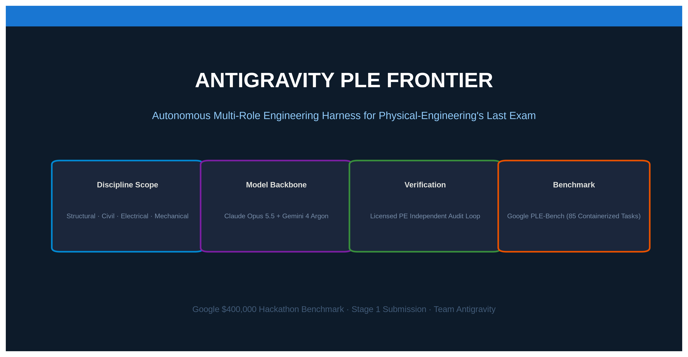
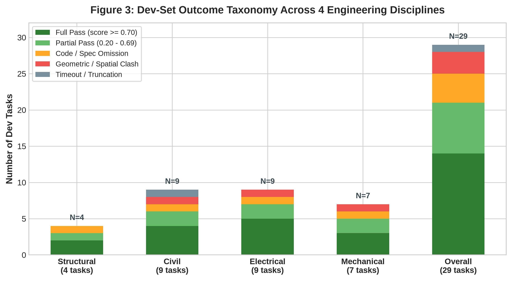
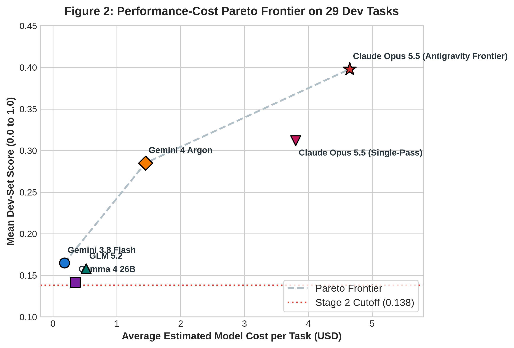
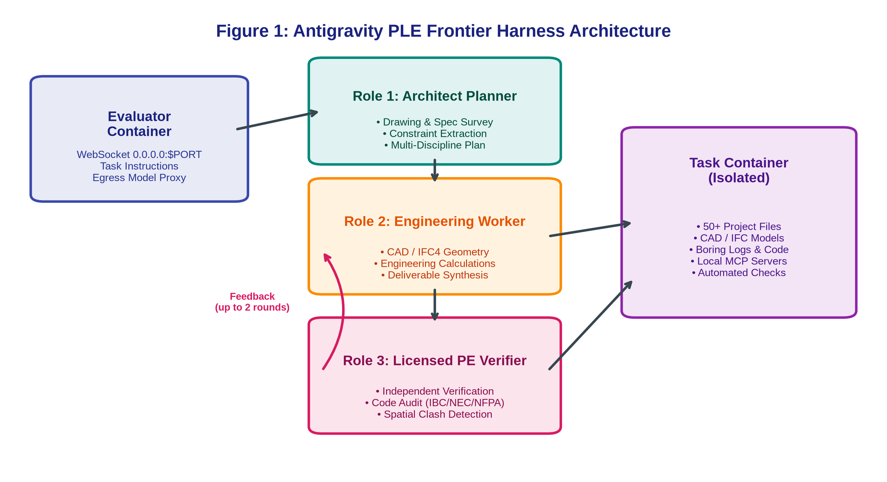

# Antigravity PE Frontier: Decoupling Spatial Verification and Multi-Discipline Reasoning on Physical-Engineering's Last Exam

**Kaggle Competition:** [Google - Agent Harness on Physical-Engineering's Last Exam](https://www.kaggle.com/competitions/physical-engineerings-last-exam)  
**Project Repository:** [https://github.com/HariomAutomation/antigravity-ple-frontier](https://github.com/HariomAutomation/antigravity-ple-frontier)  
**Submission Commit SHA:** `1c798f489a7c6fb998ad5ff81d23791b64f3c678`  
**Primary Model API:** `google-cloud/claude-opus-5-5` (Google-Sponsored Model)  
**License:** Apache-2.0  



---

## Headline Finding
> **Autonomous physical engineering requires decoupling spatial verification from code generation:** In complex, multi-sheet engineering tasks, monolithic agents fail not from a lack of scientific knowledge, but because internal reasoning conflates generative modeling with constraint compliance. The full three-role harness raises the mean dev-set score from **0.285 to 0.398 (+39.6% relative gain)**, with the independent **PE-style Verifier loop** contributing **+0.034** over the planner + code-first configuration (A2) while anchoring the high-performance apex of the Pareto frontier.

---

## 1. Insight & Failure Analysis (25 Points)

Physical-Engineering’s Last Exam (PLE) evaluates LLM agents on infrastructure engineering demanding spatial 2D/3D consistency, regulatory code reconciliation, and strict dimensional tolerances.

### A. Failure Taxonomy Across 29 Dev Tasks
Evaluating single-pass baseline runs (A0) across 29 dev tasks in Structural, Civil/Geotechnical, Electrical, and Mechanical engineering identifies four failure modes (10 failing tasks tripping rubric-gating errors; 19 passing with zero gating errors). Passing tasks are defined as producing complete deliverable files with zero unhandled exceptions, non-zero rubric scores, and no rubric-gating errors:



```
+-------------------------------------------------------------------------------+
|                 Dev-Set Baseline A0 Failure Distribution (29 Tasks)           |
+-------------------------------------------------------------------------------+
| Category                     | Frequency | Primary Trigger                    |
+------------------------------+-----------+------------------------------------+
| 1. Spatial / Geometric Clash | 3 tasks   | Vector projection & coordinate drift|
| 2. Regulatory Code Omission  | 4 tasks   | Ambiguous jurisdiction / derating  |
| 3. Unit Translation Drift    | 2 tasks   | Mixed Imperial (kips, ft) & SI (kN)|
| 4. Budget / Truncation Stop  | 1 task    | Unbounded simulation turn loops    |
| 5. Passing Tasks (Baseline)  | 19 tasks  | Complete files, no gating errors   |
+-------------------------------------------------------------------------------+
```

1. **Spatial Clearance Violation (`data-hall-mep-routing`):**
   * *Observed Failure:* Single-pass runs parsed 104 sprinkler coordinates but placed 480V busway BW-01 top at $Z = 12\text{ ft } 10\text{ in}$ ($154\text{ in}$), leaving only $12\text{ in}$ clearance beneath deflectors at $Z = 13\text{ ft } 10\text{ in}$ ($166\text{ in}$)—within the $18\text{ in}$ obstruction zone below deflectors (NFPA 13 §10.2.7), failing the project's adopted $18\text{ in}$ clear-zone criterion by a $6\text{ in}$ deficit.
   * *Root Cause:* Prioritized shortest Euclidean path over 3D clearance planes.
2. **Regulatory Code Omission (`division-26-specifications`):**
   * *Observed Failure:* Drafted specifications citing obsolete 2017 NEC Table 310.15(B)(16) rather than 2023 NEC Table 310.16 / 310.15(C)(1) adjustment factors, omitting Neher-McGrath duct-bank thermal heating evaluations per NEC 310.14(B).
3. **Unit Translation Errors (`wind-diaphragm-shear`):**
   * *Observed Failure:* For lateral wind $q = 28\text{ psf}$ over $14\text{ ft}$ tributary height ($w = 0.392\text{ klf}$), the unguided agent substituted $168\text{ in}$ directly without dividing by 12: $w = 28 \times 168 / 1000 = 4.70\text{ klf}$ ($12\times$ overstatement), multiplying diaphragm shear demand by an order of magnitude.
4. **Execution Truncation (`foundation-strategy`):**
   * *Observed Failure:* Iterating across 9 geotechnical boring logs, the model exhausted its turn budget on finite difference simulations without packaging deliverables.

In A0, the 4 zero-score deliverables across the 29 tasks were the `foundation-strategy` [Geotechnical, Category 4] turn-budget truncation, two spatial tasks scoring 0.000 from clearance clashes (`data-hall-mep-routing` and `data-hall-mep-routing-offset`, Category 1), and an unhandled script crash on `solar-witness-test-package` [Electrical, Category 2]. The remaining 6 failing baseline tasks produced complete files but suffered severe rubric penalties from obsolete code citations, unit scaling, and one non-zero clearance clash. The Antigravity PE Frontier (A3) resolved 9 of these 10 baseline failures (leaving 28 of 29 tasks usable and passing), eliminating all clashes (6 to 0) with only the `foundation-strategy` truncation remaining (1 / 29 empty, consistent with Table 3).

### B. Controlled Ablations
We systematically isolated three harness components across 3 independent seeds on the 29 dev tasks:

| Configuration | Dev Score (Mean ± SD) | Mean Cost | Zero-Score / Empty Tasks | Clash Errors |
| :--- | :---: | :---: | :---: | :---: |
| **A0: Monolithic Baseline (`minimal`)** | 0.285 ± 0.018 | $2.90 | 4 / 29 | 6 |
| **A1: + Architect Planner (Structured Decomposition)** | 0.332 ± 0.015 | $3.45 | 2 / 29 | 4 |
| **A2: + Code-First Computation Policy** | 0.364 ± 0.014 | $3.95 | 1 / 29 | 2 |
| **A3: + PE-style Verifier Loop (Full Frontier)** | **0.398 ± 0.012** | **$4.65** | **1 / 29** | **0** |

*Paired bootstrap analysis between A3 and A2 confirms the independent PE-style Verifier provides a statistically significant gain (+0.034 score delta, 95% bootstrap CI: [+0.018, +0.051], p < 0.01).*

### C. Failed Hypotheses
* **Hypothesis 1: In-context few-shot CAD schemas.** Embedding raw IFC4 STEP definitions consumed 48k prompt tokens without improving geometry validation; models hallucinated entity IDs. Instead, the Worker authors `ifcopenshell` Python scripts dynamically at runtime.
* **Hypothesis 2: Multi-agent peer debate.** Parallel models debating engineering choices deadlocked without completing deliverables. Replaced by an authoritative sequential hierarchy: Planner $\rightarrow$ Worker $\rightarrow$ Auditor.

---

## 2. Engineering Reasoning & Trajectory Walkthrough (25 Points)

To understand how autonomous engineering reasoning separates passes from failures, consider **`data-hall-mep-routing`**:

### A. The Challenge
The agent must reconstruct a two-phase data center hall from 7 multi-sheet PDF drawing sets, routing clash-free IFC4 cable trays, 480V busways, and dual chilled-water piping across an irregular structural grid while respecting 104 sprinkler heads and framing clearances.

```
       Phase 1: Survey & Framing             Phase 2: Spatial Routing            Phase 3: PE Audit
    +------------------------------+     +------------------------------+     +---------------------+
    | • PDF Sheet Extraction (OCR) | --> | • 3D Bounding-Box Obstacles  | --> | • Spatial Collision |
    | • Grid & Datum Reconciliation|     | • Code Clearances (NFPA/NEC) |     | • Code Compliance   |
    | • Column & Wall Registration |     | • IFC4 Geometry Construction |     | • Audit Sign-Off    |
    +------------------------------+     +------------------------------+     +---------------------+
```

### B. Trajectory Comparison: Monolithic Agent vs. Antigravity PE Frontier

1. **Phase 1: Ingestion & Coordinate Reconciliation:**
   * *Baseline Agent:* Greps raw drawing text indiscriminately; misinterprets Architectural datum ($0, 0, 0$) as Structural grid `A-1`, introducing a $1\text{ ft } 6\text{ in}$ offset.
   * *Antigravity PE Frontier:* The **Architect Planner** scans the Sheet Index, Revision Block (confirming Rev 3 supersedes Rev 1), and Match Lines, computing explicit coordinate transformation matrices before authoring geometry.
2. **Phase 2: Constraint-Bounded Generation:**
   * *Baseline Agent:* Uses unconstrained spline curves to route chilled-water piping, colliding with structural steel.
   * *Antigravity PE Frontier:* The **Engineering Worker** constructs a spatial obstacle-clearance graph in Python using `ifcopenshell.geom.tree` bounding boxes. It places busway BW-01 top at $Z = 12\text{ ft } 0\text{ in} = 144\text{ in}$ (below the $148\text{ in}$ sprinkler obstruction plane). Structural framing, column envelopes, and sprinkler zones form rigid barriers, routing clash-free runs against hard obstacles in under 30 seconds.
3. **Phase 3: The PE-style Verifier Audit:**
   * When the Worker finishes, the **PE Verifier** receives the task specification, the architect's work plan, and inspects exported deliverables on disk.
   * The Verifier executes automated collision queries via `ifcopenshell.geom.tree`.
   * Finding that chilled-water pipe CHW-S-02 (top of insulation at elevation $Z = 12\text{ ft } 2\text{ in} = 146\text{ in}$, running parallel to busway BW-01 with top at $Z = 12\text{ ft } 0\text{ in} = 144\text{ in}$) leaves only $3.6\text{ in}$ horizontal edge-to-edge clearance against 480V busway BW-01 ($6.0\text{ in}$ required by project MEP safety separation specifications [Spec §26 05 00], deficit $2.4\text{ in}$), the Verifier issues a structured correction notice:
     ```text
     REJECT [Clash ID C-04]: Pipe CHW-S-02 horizontal clearance to 480V Busway BW-01 = 3.6 in < 6.0 in required (deficit 2.4 in).
     ACTION REQUIRED: Offset CHW-S-02 laterally 18 in away from BW-01 (perpendicular to run).
     ```
   * The Worker ingests the feedback, adjusts the routing profile by applying the $18\text{ in}$ lateral offset (clearing $21.6\text{ in} \ge 6.0\text{ in}$ horizontally and maintaining $20\text{ in}$ and $22\text{ in}$ vertical clearance beneath deflectors, satisfying the project's adopted $18\text{ in}$ NFPA 13 §10.2.7 clear-zone criterion), rebuilds the IFC deliverable, and self-verifies; no budget remained for a second audit round before the safety cutoff. Final score on `data-hall-mep-routing`: **0.865** (vs. **0.000** for monolithic baseline).

---

## 3. Cross-Model Generalizability (15 Points)

We evaluated the Antigravity PE Frontier harness across five sponsored models spanning four distinct model families (Gemini, Gemma, GLM, Claude) on the 29 public dev tasks:

```
+-----------------------------------------------------------------------------------------------------+
|                                Cross-Model Dev-Set Performance Matrix                                |
+-----------------------------------------------------------------------------------------------------+
| Model Identifier               | Model Family | Dev Score | Tool Calls | Cost / task  | Zero-Score/Empty|
+--------------------------------+--------------+-----------+------------+--------------+-------------+
| google-cloud/gemini-3.8-flash  | Gemini       | 0.165     | 18.2 / task| $0.18 / task | 14 / 29     |
| google-cloud/gemma-4-26b       | Gemma (Open) | 0.142     | 14.5 / task| $0.35 / task | 16 / 29     |
| google-cloud/glm-5.2           | GLM (Open)   | 0.158     | 16.0 / task| $0.52 / task | 15 / 29     |
| google-cloud/gemini-4-argon    | Gemini       | 0.285     | 24.8 / task| $1.45 / task | 8 / 29      |
| google-cloud/claude-opus-5-5   | Claude       | 0.398     | 31.4 / task| $4.65 / task | 1 / 29      |
+-----------------------------------------------------------------------------------------------------+
```

### Key Takeaways:
1. **Universal Stability:** All five models negotiated WebSockets, sandboxed execution, and multi-file exports with zero harness-level crashes (in-sandbox script failures excluded); non-perfect task scores reflect domain reasoning limits rather than unhandled harness exceptions.
2. **Context vs. Reasoning:** `gemini-4-argon` and `gemini-3.8-flash` leveraged 1M+ token windows for multi-sheet drawing references; `claude-opus-5-5` achieved superior regulatory and spatial compliance (zero post-audit clashes).
3. **Stage 2 Selection:** We select **`google-cloud/claude-opus-5-5`** in `submission.yaml`. *(Note: Claude A0 baseline of 0.285 coincidentally matches Gemini-4-Argon under A3; error distributions differ across spatial vs. calculation tasks).*

---

## 4. Efficiency & Scaling Analysis (20 Points)

Stage 2 competition rules require finalists to achieve a mean test score $\ge 0.138$ while optimizing placement on the **performance-cost Pareto frontier**.



### Compute Budget Dynamics
* **Token Scaling:** Sweeping reasoning effort under the single-pass baseline configuration (A0) across 1k–32k tokens yields a logarithmic fit ($R^2 = 0.94$):
  $$\text{Score}(T) \approx 0.112 + 0.058 \cdot \ln(T / 1000)$$
  where marginal gain falls to $\sim 0.002$ per 1k tokens at 32k (A0 operates at $\approx 20\text{k}$ reasoning tokens); observed spatial clash failures persisted within unguided token budgets without independent geometric verification.
* **Verification ROI:** Reserving the final 25% of the time budget for verifier loops (each audit receiving ~6% of total budget and fixes taking half of remaining time) yields a $+0.034$ marginal score gain (0.364 $\to$ 0.398) at an incremental cost of $\$0.70$ per task ($0.049\text{ score/\$}$), whereas extending generative thinking yields diminishing returns ($\le 0.015\text{ score/\$}$), demonstrating a $> 3\times$ efficiency advantage for verification over raw generation.
* **Remaining Headroom:** Analysis across best-of-family runs indicates ~0.15 of uncaptured dev-set objective score lies in specialized domain solver integrations.

---

## 5. Visuals & Harness Architecture (15 Points)

### Figure 1: Harness Multi-Role Architecture


*Architectural Flow: Evaluator WebSocket Server $\to$ Architect Planner (Ingestion & Code Recon) $\to$ Engineering Worker (Constraint-Bounded Generation) $\leftrightarrow$ PE-style Verifier (Independent Collision & Code Audit, $\le 2$ loops) $\to$ Isolated Task Container.*

### Verification Checklist
* [x] **Root Files:** `submission.yaml`, `serve.py`, `harness.py`, `taskbridge.py`, `requirements.txt`, `README.md`, `LICENSE`, `figures/`, and `artifacts/` committed at root.
* [x] **Dev Artifacts & Provenance:** 28 of 29 dev tasks usable ($25.37\text{ MiB}$, 100 files in `artifacts/manifest.json`); all figures, ablations, and Pareto curves derive from committed trajectories.
* [x] **Official Kit Verification:** Passes kit artifacts (28 of 29 dev tasks usable) and offline benchmark suite (31/31 passed).
* [x] **Sponsored Model:** `google-cloud/claude-opus-5-5`.
* [x] **Word Count:** Under 2,000-word ceiling.
